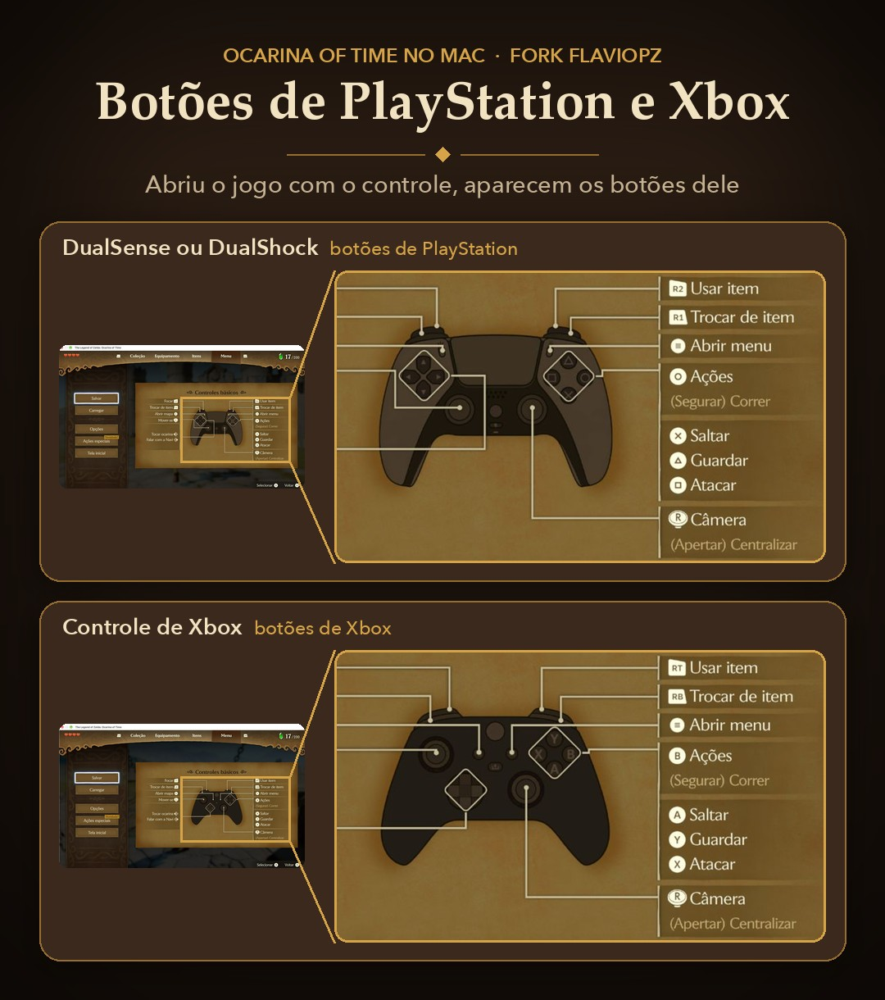

# nxnative

> ## This fork: The Legend of Zelda: Ocarina of Time on Apple silicon Macs
>
> **This fork is focused on one game: the Switch 2 remake of The Legend of Zelda: Ocarina of Time, on the Mac.** Its changes were made and tested for that game only. Other games have not been tested with this fork: some changes (the movie pacing and the controller button overlay in the host, the build script's options) apply to every game and may behave differently there. For any other game, use the upstream project, [seedds/nxnative](https://github.com/seedds/nxnative).
>
> This is a personal fork of [seedds/nxnative](https://github.com/seedds/nxnative) (kept up to date with its `main`; last merged at `3304d6a0`) with the changes needed to play **The Legend of Zelda: Ocarina of Time** (Switch 2, `0400486024DEC000`, update v131072) smoothly on Macs slower than the M6 the upstream profile was measured on. It was tested on a **MacBook Air M4 (16 GB, fanless)**. It is not affiliated with the upstream project or with Nintendo, and no game files are included: you need your own dump of the game.
>
> ### What this fork changes
>
> Upstream now has its own frame step for this game (correct speed below 60 fps) and holds it at full resolution with a **Dynamic resolution** switch in the launcher; this fork uses those and adds the rest below.
>
> | Change | Why |
> |---|---|
> | **Larger model resource GPU heap** (`patches.py`) | Twice the configured `ModelResourceMgrGpuHeap`. With the original size the heap fills in Hyrule Field and the game crashes. |
> | **PlayStation / Xbox button prompts** ([`button_mods/`](dm/games/0400486024DEC000/button_mods/)) | The build generates RomFS overlays with the button glyphs, HUD and ocarina icons and the controls screen art for a DualSense / DualShock and an Xbox pad. The host picks one from the controller connected at start (`DM_BUTTONS` / `DM_BOTOES` = `ps`, `xbox`, `nintendo` or `auto` forces it). No effect on performance. |
> | **Build progress** ([`scripts/build_ipa_from_nsp.py`](scripts/build_ipa_from_nsp.py)) | The shader library packing and the pipeline archive stages show progress instead of looking frozen for minutes. |
> | **`--icon <image>`** (`scripts/build_ipa_from_nsp.py`) | Gives the app an icon of your choice. A NUP usually has no icon data, which left the app's icon blank. |
> | **Movies at 60 fps, in step with their narration** (`patches.py`, `movie_fps 60` in `game.tsv`, [`dm/host/hle_codec_video.c`](dm/host/hle_codec_video.c)) | The game's movies are 60 fps and its player takes one picture per frame, with the narration and subtitles counting frames too: at 30 fps the opening played at half speed, its sound and narration out of step. Movies now play at 60 while the game stays at 30: the player skips the NDVE enhancement networks (about 29 ms of GPU a frame on an M4), and the host holds 60 fps only while a movie plays. If a Mac still cannot take every picture, the host passes over the ones already behind the movie's clock (`DM_MOVIE_PACE=0` turns that off). |
> | **Pipeline archive mapped from an external drive** (upstream PR [#1817](https://github.com/seedds/nxnative/pull/1817) by Mariano Abad, picked ahead of its merge) | With the app on a USB drive, macOS read the 3 GB pipeline archive bundled with the app into memory for the whole run. It is now mapped: about 3 GB less memory (13.5 → 10 GB measured here), so an app on an external drive needs no copy to the internal one for memory's sake. |
>
> #### Upstream fixes picked ahead of their merge
>
> These are open pull requests on [seedds/nxnative](https://github.com/seedds/nxnative), each kept as its author's commit and tested in play here. When upstream merges one, the next merge takes upstream's version; if upstream takes another route, this fork follows it.
>
> | Pull request | What it fixes |
> |---|---|
> | [#2030](https://github.com/seedds/nxnative/pull/2030) (humanperzeus) | White clouds and haze over the ferns and the path between Kokiri Forest and Hyrule Field: a light shader writes NaN at alpha 0, which NVIDIA's blender drops and Apple's stored ([issue #1839](https://github.com/seedds/nxnative/issues/1839)). Its rebuilt version (`f67642dc`, with the review fix that reaches the 9,265 pixel shaders whose `main0` shares its body). Chain change: a full build. |
> | [#2219](https://github.com/seedds/nxnative/pull/2219) (Know-It-All-Brother) | Stretched and flickering vertices on the horses at Lon Lon Ranch, Link's slingshot and the ReDeads' faces: the game reads its uniform buffers past the size it binds, and main's bound (`26062f9e`) gave zeros there ([issue #2218](https://github.com/seedds/nxnative/issues/2218)). Host only, no chain change. |
>
> Picked here earlier and since merged upstream (this fork now has upstream's version): [#2077](https://github.com/seedds/nxnative/pull/2077) (Roan de Graaf; ground turning into crossing stripes, "plaid", after a few area changes), [#2022](https://github.com/seedds/nxnative/pull/2022) and [#2075](https://github.com/seedds/nxnative/pull/2075) (sleepyeyedjoe, Adam Kratch; models and scenery drawing black or dark for a frame when the game streams in a texture), [#2085](https://github.com/seedds/nxnative/pull/2085) (Pedro Nascimento; about 9 fps in Castle Town on a 16 GB Mac, 16.2 GB of GPU memory allocated there before, 6.9 GB after).
>
> 
>
> ### Credits
>
> **Flávio Pereira** ([flaviopz/nxnative](https://github.com/flaviopz/nxnative)) created the PlayStation and Xbox button mods (the generator and the controller drawings, and the picture above) and first found the model heap and plain movie renderer patches for this game (and a frame step and render scale that upstream has since replaced with its own). This fork ports them onto the current upstream code, fixes the generator's indentation error and lint findings, and leaves out his other changes, which upstream has since covered. Everything else is the upstream project's work: see [Acknowledgements](#acknowledgements).
>
> ### Results on a MacBook Air M4 (Kokiri Forest)
>
> | Build | Frame rate | Notes |
> |---|---|---|
> | flaviopz fork | 26–30 fps, dips to 10–18 | CPU-bound: texture pool tables rebuilt 1,000 times (16.5 s in 3 min) |
> | upstream `main` | 40–58 fps, uneven | GPU-bound, game at about 75% speed, 14.5 GB of memory with no headroom |
> | **this fork**, 30 fps, render scale 0.85 (before upstream's full-resolution and frame-step changes) | **locked 30 fps** | frame p95 34 ms, 0–1 frames dropped per 300, GPU about 28 ms per frame, CPU about 130% |
> | **this fork** now (upstream `37f076a5` + the changes above), 30 fps, full resolution | **30 fps**, 0 frames dropped in most 300-frame windows | GPU p50 22 / p95 28 ms per frame in a busy area, about 10 GB of memory; no flickering dark specks or pale patches (fixed upstream). Short freezes (0.5–1.2 s) the first time some foliage and shadow (task / mesh) pipelines appear after a new build: Metal compiles them then and keeps them, so they do not come back on later runs |
> | **this fork** now (upstream `04811a63` + the pull requests above), 30 fps, full resolution, Castle Town | **30 fps** | GPU p50 26–27 ms per frame, 6.9 GB of GPU memory allocated (16.2 GB and about 9 fps before #2085) |
>
> Recommended launcher settings on a 16 GB M4: Console mode **Handheld**, Frame rate **30**, Dynamic resolution **off** (full resolution; turn it on if the frame rate drops), Encode thread **on**, Display **Fullscreen**, Game Mode left off (macOS Game Mode holds the GPU at its lowest clock). Close other apps while playing: the game takes about 10 GB.
>
> ### Building and playing it, step by step
>
> **What you need**
>
> - An Apple silicon Mac with **macOS 26.6 or later**. Tested on a MacBook Air M4 with 16 GB; 16 GB is the practical minimum, because the game itself takes about 14.5 GB.
> - **Xcode 27.2** (the shaders are built with its Metal compiler), **[Homebrew](https://brew.sh)** and an arm64 **Python 3.12 or newer** (3.14 recommended).
> - **Your own dump of the game** as one `.nup` file (Switch 2, update v131072). No `prod.keys` are needed for a NUP.
> - **About 120 GB of free space** while building, and about 37 GB afterwards: see **Storage** just below. Most Macs do not have that much free on their internal drive, and they do not need to.
>
> #### Storage: build on an external drive
>
> The build keeps several large copies of the game at once. Measured here:
>
> | Item | Size | What it is |
> |---|---|---|
> | the game's `.nup` | 25.6 GB | your dump, the build's input |
> | `0400486024DEC000_build/extract/` | about 24 GB | the game's files unpacked into one image the host reads quickly |
> | `0400486024DEC000_build/shader/` | about 25-30 GB | about 42,800 shaders translated to Metal, and their compile cache |
> | `0400486024DEC000_build/pso/` | about 8-10 GB | Metal pipelines compiled ahead of time |
> | `The Legend of Zelda - Ocarina of Time.app` | about 37 GB | the app: the game's files, the shader libraries and the pipeline archive inside it |
> | **at the peak of a build** | **about 120 GB** | on one APFS drive the app's files are cloned from the build folder rather than copied, so the space actually used is somewhat less |
>
> Mac internal drives are often small, so **build on an external SSD or hard drive**: put the clone, the Python environment, the `.nup` and the build folder there (steps 2 to 5 below use `/Volumes/SSD`). Nothing large goes on the internal drive: the save, your `env.txt` and a pipeline cache of a few hundred MB live in `~/Library/Application Support/nxnative/`.
>
> **Playing:** the app runs from the external drive if the drive is fast (an NVMe SSD over USB4 / Thunderbolt reads at 2-3 GB/s, close to an internal drive). If yours is slower (a hard drive, a SATA SSD in a USB enclosure, or a drive behind a shared hub), copy just the finished app to the internal drive and play from there; it needs about 37 GB free:
>
> ```
> ditto "/Volumes/SSD/Ocarina of Time/The Legend of Zelda - Ocarina of Time.app" "/Applications/The Legend of Zelda - Ocarina of Time.app"
> ```
>
> The first launch after a copy, macOS verifies the whole app once; let it finish. Saves are not inside the app, so they carry over.
>
> **After the build**, only the app is needed to play. Deleting the `0400486024DEC000_build` folder and the `.nup` frees space, but any later rebuild (an update of this fork, a different option) then needs the `.nup` again and redoes the shaders and pipelines (about 3 hours instead of minutes). If you can, keep both on the external drive.
>
> **1. Install the tools** (once), in Terminal:
>
> ```
> sudo xcode-select -s /Applications/Xcode.app
> xcodebuild -downloadComponent MetalToolchain
> brew install zstd glslang
> brew install --cask dotnet-sdk
> ```
>
> With several Xcode versions installed, name this one `Xcode-27.2.app` and select it with `sudo xcode-select -s /Applications/Xcode-27.2.app`.
>
> **2. Get this fork** on the drive you will build on (the examples use `/Volumes/SSD`; change it to yours):
>
> ```
> cd /Volumes/SSD
> git clone -b ocarina-of-time-mac https://github.com/betogzo/nxnative.git
> cd nxnative
> ```
>
> **3. Make a Python environment** for the build tools and the button generator:
>
> ```
> python3 -m venv /Volumes/SSD/venv-nx
> /Volumes/SSD/venv-nx/bin/pip install -r .github/requirements/tools.txt scipy shapely astc-encoder-py "backports.zstd; python_version < '3.14'"
> ```
>
> `backports.zstd` is needed only below Python 3.14. `scipy`, `shapely` and `astc-encoder-py` are only for the PlayStation / Xbox buttons; without them the build skips the buttons with a warning and the game shows its own.
>
> **4. Put the game in a folder of its own**, for example:
>
> ```
> /Volumes/SSD/Ocarina of Time/The Legend of Zelda Ocarina of Time [0400486024DEC000][v131072].nup
> ```
>
> The build creates `0400486024DEC000_build/` (extracted files, shaders, logs) next to it and writes the app there too.
>
> **5. Build the Mac app.** Keep the Mac on power; `caffeinate -i` stops it from sleeping during the build:
>
> ```
> cd /Volumes/SSD/nxnative
> caffeinate -i /Volumes/SSD/venv-nx/bin/python scripts/build_ipa_from_nsp.py "/Volumes/SSD/Ocarina of Time/The Legend of Zelda Ocarina of Time [0400486024DEC000][v131072].nup" --platform mac-app
> ```
>
> The stages, as seen on the MacBook Air M4:
>
> | Stage | First build | What happens |
> |---|---|---|
> | unpack | about 1 min | the NUP's RomFS becomes one image in `extract/` |
> | check files | seconds | every `.zs` file must be a zstd stream (see below) |
> | rewrite | about 1 min | the game's code is rewritten for the Mac, with this fork's patches |
> | shader split + Mac shaders | about 2 hours | about 42,800 shaders translated to Metal; progress is shown |
> | Mac host | under 1 min | the native host program |
> | pipeline archive | about 1 hour | Metal pipelines compiled ahead of time; progress is shown |
> | Mac app | a few minutes | the button mods are generated, then everything is packed and signed |
>
> Do not cancel the long stages. Later builds reuse the extraction, the shaders and the pipelines: a rebuild after a code change took 13 minutes.
>
> **App icon**: a NUP usually carries no icon, so the app's icon is blank. Add `--icon <image>` (JPEG, PNG, WebP or HEIC, any shape: it is cropped to its centre square and scaled to 1024x1024) to give it one, or set `ICON` at the top of `scripts/build_ipa_from_nsp.py` so every build uses it. Use a square image of at least 1024x1024 for a sharp icon. Only the icon is rebuilt: a few minutes when the rest is reused.
>
> **If the build stops with `3 damaged`**: some NUP dumps of v131072 hold three `.zs` textures that begin with zeros (`CmnTex_Map_Soil_FairyFountain_Floor_D_Nrm`, `RBake_Scene_GanonStage_G_2_1_d0_t0`, `Rock_WaterTemple_Gate_M_01_Nrm`). With them the game reloads the Kokiri Forest fairy fountain model forever and wastes about one CPU core for the whole session. Use another dump of the same version; `--allow-damaged` builds anyway, but you keep that cost.
>
> **6. Open the app** from Finder: `The Legend of Zelda - Ocarina of Time.app` in the game's folder. The first time, macOS verifies the 37 GB app; let it finish. You can run it from the external drive.
>
> **7. Settings in the launcher** (the window before the game starts). Recommended on a 16 GB M4:
>
> | Setting | Value | Why |
> |---|---|---|
> | Console mode | Handheld | lower base resolution, the mode the profile was tested in |
> | Frame rate | 30 | half the GPU work, steady pacing on a 60 Hz screen, correct game speed |
> | Dynamic resolution | off | upstream holds the game at full resolution (1536x864) by default; turning it on lets the game lower its resolution when the GPU falls behind |
> | Encode thread | on | moves Metal encoding off the submit thread |
> | Display mode | Fullscreen | the picture goes straight to the screen |
> | Performance HUD | optional | shows fps, GPU time and memory |
>
> **8. Controllers.** Connect a DualSense, DualShock 4 or Xbox controller **before** opening the game: the buttons are chosen once, at start. To force a set, put one line in `~/Library/Application Support/nxnative/0400486024DEC000/env.txt`: `DM_BUTTONS=ps`, `DM_BUTTONS=xbox` or `DM_BUTTONS=nintendo` (`DM_BOTOES` works too).
>
> **9. Where things are**
>
> - Saves: `~/Library/Application Support/nxnative/0400486024DEC000/save`. They live outside the app, so rebuilding keeps them.
> - Your switches: `~/Library/Application Support/nxnative/0400486024DEC000/env.txt`, one `KEY=value` per line, read on every start.
> - Logs: `~/Library/Logs/nxnative/0400486024DEC000.log` and `.prev.log`. Only the last two runs are kept, so copy a log you want to keep before playing again.
>
> **10. Updating**: `git pull` in the `nxnative` folder, then run the same build command. Only what changed is rebuilt.
>
> **Tips**
>
> - Close other apps while playing. The game takes about 14.5 GB, and on a 16 GB Mac anything else pushes it into swap, which brings stutter and late textures.
> - Leave macOS Game Mode off. The app turns it off on purpose: it holds the GPU at its lowest clock.
> - Exclude the build drive from Spotlight (`sudo mdutil -i off /Volumes/SSD`, or System Settings → Spotlight → Search Privacy) so it does not index the build's files.
> - If an external SSD disconnects during heavy writes, check its power. A drive sharing a bus-powered hub with other devices failed every write after about 200 MB here; plugged straight into the Mac, or behind a hub with its own power supply, it wrote 64 GB without an error.
> - A fanless Mac lowers its clocks when hot. A hard surface, or a stand with air under it, helps it hold 30 fps in long sessions.
>
> The upstream README follows.

Play your own Nintendo Switch and Switch 2 games natively on Apple silicon Macs, iPhone and iPad. One script packs your game into a Mac app or an unsigned IPA that you sideload.

It is not an emulator: the game's own code runs directly on the Apple chip, with Switch graphics rebuilt on Metal. Nothing from any game is in this repository, and the project is not affiliated with Nintendo or any game publisher.

[Games](#games) · [Community front ends](#community-front-ends) · [Requirements](#requirements) · [How to play](#how-to-play) · [Discussions](#discussions) · [For developers](#for-developers)

## Games

The full [tested games table](dm/games/README.md#games) includes original Switch games, tested builds, engines and graphics APIs. Each game's note records its tested platforms, progress and known issues.

These Switch 2 games have passed Mac gameplay testing. Build them from a [`.nup` file or a dump folder](#switch-2-games):

- [Donkey Kong Bananza](dm/games/040074A01BF12000/README.md)
- [Fire Emblem Fortune's Weave](dm/games/04007EF01F8AE000/README.md) — up to 120 fps
- [Hyrule Warriors: Age of Imprisonment](dm/games/04003F40232DE000/README.md)
- [Kirby Air Riders](dm/games/040077201BE50000/README.md)
- [Mario Kart World](dm/games/0400C3F00006E000/README.md)
- [Mario Tennis Fever](dm/games/0400D4201C6EA000/README.md)
- [Pokémon Pokopia](dm/games/0400A3A01EE4C000/README.md)
- [Splatoon Raiders](dm/games/0400380020056000/README.md)
- [Star Fox](dm/games/0400E88025B1A000/README.md)
- [The Legend of Zelda: Ocarina of Time](dm/games/0400486024DEC000/README.md)
- [Yoshi and the Mysterious Book](dm/games/0400245021D2C000/README.md)

## Community front ends

Community projects build on nxnative with tools to turn your games into apps for your iPhone, iPad or Mac without the command line, and libraries to organize and launch them. They are separate projects: questions and bugs about them go to their own pages.

- [NX2Apple](https://github.com/LNPANDY/NX2Apple) — Mac builder with a shared iPhone/iPad game library.
- [NX Play](https://github.com/varyform/nx-native-wrapper) — Mac library with device installs and save sync.
- [NxNative Launcher](https://github.com/rennan101/nxnative_Launcher) — Mac launcher with guided builds and controller mapping.
- [LumaNX](https://github.com/Xc1Ym/LumaNX) — Mac game builder with IPA export.
- [GameCase](https://github.com/Tiaoge-tou/GameCase) — iOS game library based on LiveContainer.

## Requirements

- **Mac:** Apple silicon, macOS 26.6 or later. Building games requires Xcode 27.2.
- **iPhone:** A17 Pro chip or later, with iOS 26 or later.
- **iPad:** M1 chip or later, with iPadOS 26 or later.

The games' textures are BC-compressed, which older iPhones cannot read. Switch 2 builds are tested on the Mac; check each game's note for device-specific validation.

For a game without a profile, the script writes a survey and tries a provisional build with guessed settings. That build may not start; see [Port another game](docs/development.md#port-another-game).

## How to play

Switch 2 games are built from one `.nup` file or a folder of their files, not from NSPs, and are tested on the Mac only: see [Switch 2 games](#switch-2-games).

### Build from the command line

You need a Mac with macOS 26.6 or later, [Xcode](https://developer.apple.com/download/all/?q=Xcode%2027.2) 27.2, [Homebrew](https://brew.sh) and Python 3.12 or newer (an arm64 one, not an Intel Homebrew's). An iPhone build also needs Xcode's iOS platform (Xcode → Settings → Components).

The shaders are built with Xcode 27.2's Metal compiler. Select it before step 1: `sudo xcode-select -s /Applications/Xcode.app`. With several Xcode versions installed, name this one `Xcode-27.2.app` and select it with `sudo xcode-select -s /Applications/Xcode-27.2.app`.

**1. Install the tools** (only once), in Terminal:

```
xcodebuild -downloadComponent MetalToolchain
git clone https://github.com/seedds/nxnative.git && cd nxnative
brew install xcodegen zstd glslang
python3 -m pip install lz4 "capstone>=5,<6" fonttools nsz zbic "backports.zstd; python_version < '3.14'"
```

**2. Put your game in a folder**: the game, plus its update and DLC if you have them (`.nsp`, `.xci`, `.nsz` or `.xcz`):

```
~/Games/MarioWonder/
  Super Mario Bros. Wonder [010015100B514000][v0].nsp
  Super Mario Bros. Wonder [010015100B514800][v327680].nsp
```

**3. Build**, with your game folder and your `prod.keys`:

```
python3 scripts/build_ipa_from_nsp.py ~/Games/MarioWonder -k ~/keys/prod.keys
```

The IPA appears in the game's folder. The first build takes 30–60 minutes and needs free disk space of about twice the game's size plus 10 GB; building again is much faster.

To play on the Mac instead, add `--platform mac-app`: you get a Mac app of the game to open from Finder. All options: [The packing script in detail](docs/development.md#the-packing-script-in-detail).

### Install

Install the IPA on your iPhone or iPad with a sideloading tool such as AltStore, Sideloadly or LiveContainer. If your tool offers **Increased Memory Limit**, turn it on: the bigger games need it.

Game too big to install? Build again with `--romfs separate`, and run the command the script prints once to copy the game files to your phone ([Quick reinstalls](docs/development.md#quick-reinstalls)). With AltServer, also add `--shader-files`: it cannot install a file of 2 GiB or more.

Controls, saves and settings: [Playing](docs/playing.md).

### Switch 2 games

A Switch 2 game is built from one [NUP](https://github.com/a55uka/nup) container (a `.nup` file) or a folder of its files, not from NSPs. Neither needs `prod.keys`. A game this project has no profile for is surveyed and gets a provisional profile, as NSPs do ([Port another game](docs/development.md#port-another-game)), which may not boot. You get a Mac app; iPhone and iPad are untested.

**From a `.nup` file**, which holds the base game, its updates and DLC in one file. Give the file, or a folder that holds it:

```
python3 scripts/build_ipa_from_nsp.py ~/Games/DonkeyKongBananza.nup --platform mac-app
```

[Hyrule Warriors: Age of Imprisonment](dm/games/04003F40232DE000/README.md) is played this way: its 47 GB NUP unpacks in under five minutes. A NUP that carries the game's control data (its NACP) and icon gives the app the game's name and icon; otherwise the name comes from the game's profile and the app has no icon unless you give it one with `--icon <image>` (`ICON` in Spyder; a JPEG or PNG of any size).

A NUP without the base game also works, when its base package is empty or it has none and its updates are marked `standalone_update`: the update is taken as the whole game, and the script says so. If the game then stops on missing files, that update holds only what changed: pack a NUP with the base game. The newest update is selected by default; `--package v<N>` selects another version in the container. Such a container has no `v0` (base game) to select.

**From a folder of files**. The script expects this layout (`updates` and `dlc` are optional):

```
~/Games/DonkeyKongBananza/
  base/exefs/                     main, main.npdm, sdk, rtld
  base/romfs/
  updates/458752/exefs/           the update's version, as a decimal number
  updates/458752/romfs/           the patched RomFS, not a patch
  dlc/040074a01bf13001/0/romfs/   the DLC's title ID
```

```
python3 scripts/build_ipa_from_nsp.py ~/Games/DonkeyKongBananza --platform mac-app
```

An update's folder alone will do (no `base/`), and so will `exefs/` and `romfs/` directly in the folder, as `nup extract` writes them, which count as `base/`. The app has no icon, because the folder holds none; `--icon <image>` (`ICON` in Spyder) gives it one. To turn such a folder into a NUP: `nup pack ~/Games/DonkeyKongBananza game.nup`.

## Discussions

Questions, how a game runs on your Mac or iPhone, and ideas go in [Discussions](https://github.com/seedds/nxnative/discussions); [Issues](https://github.com/seedds/nxnative/issues) are for bugs, with the log. Ocarina of Time's performance (frame rate, resolution, which Macs hold 60 fps) is followed in [Ocarina of Time: state on main](https://github.com/seedds/nxnative/discussions/1789).

## For developers

[How it works](docs/development.md) · [Game notes](dm/games/README.md#games) · [Bring-up and debugging](docs/agents/README.md) · [Front ends](docs/frontends.md) · [Contributing](CONTRIBUTING.md)

## Acknowledgements

This project is built on other people's work ([licenses](dm/third_party/README.md)):

- **[d2r-mobile](https://github.com/jhaizhou-ops/d2r-mobile)** (MIT) developed this native-execution approach, for Diablo II: Resurrected. nxnative started as a copy of its generic parts: the NSO rewriter, the host that stands in for Horizon, the NVN-on-Metal layer and the iOS app shell. Fixes go both ways.
- **Ryujinx** (MIT): its shader translator (`Ryujinx.Graphics.Shader`, `Ryujinx.Common` and `Spv.Generator` 1.3.2, in `dm/third_party/ryujinx` with a few fixes listed in [its README](dm/third_party/ryujinx/README.md)) turns the games' shaders into SPIR-V. Its emulation of the kernel and system services is also a reference when the host's behaviour is in doubt.
- **[Atmosphère](https://github.com/Atmosphere-NX/Atmosphere)**: its kernel, mesosphère, is the reference for Horizon's synchronization semantics (address arbiter, condition variables).
- **[LibHac](https://github.com/Thealexbarney/LibHac)**: reads NSPs and layers updates over the base game in `dm/tools/nx_extract`.
- **[SPIRV-Cross](https://github.com/KhronosGroup/SPIRV-Cross)**: SPIR-V to Metal Shading Language.
- **[glslang](https://github.com/KhronosGroup/glslang)** compiles the GLSL of OpenGL games to SPIR-V for it.
- **[MacNativeGames](https://github.com/ly05010419/MacNativeGames)** (MIT): the GPU widening of 8-bit indices and in-pass clears in `dm/gfx/nvn/nvn_mtl.m`, and the visibility-counter lowering in the shader translator.

## License

MIT ([LICENSE](LICENSE)). Third-party code keeps its own license ([dm/third_party](dm/third_party/README.md)).
